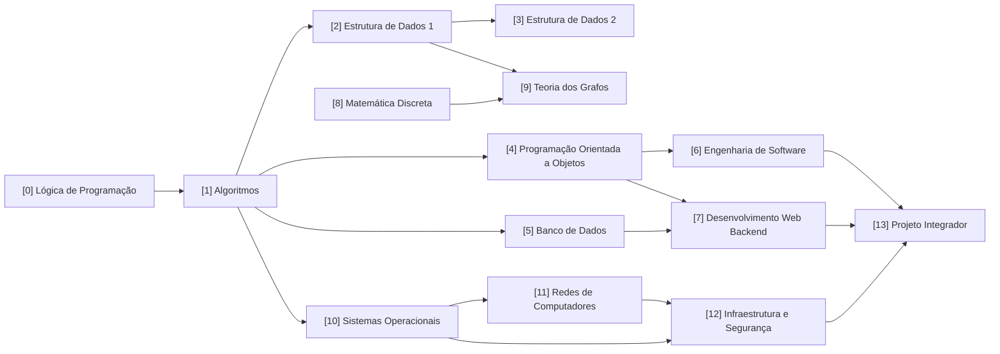

# Grafo de Pré-requisitos de Disciplinas (C)

**Matéria:** Estratégias de Programação

Implementação de grafos em C · **Tema 4: Universidade — pré-requisitos de disciplinas**

## Integrantes

| # | Nome |
|---|------|
| 1 | _Arthur Gabriel Teotonio Stellato_ |
| 2 | _ABNER EDUARDO DE BRITO TORRES_ |
| 3 | _CARLOS EDUARDO PEREIRA_ |

## Sobre

Programa em C (só biblioteca padrão) que representa as dependências entre as disciplinas de um curso como um **grafo direcionado**. Pelo menu dá pra percorrer o grafo com **DFS** e **BFS**, ver o passo a passo de cada busca, e descobrir **o que precisa ser concluído antes de cursar uma disciplina**.

## Modelagem

| Conceito do problema | No grafo |
|---|---|
| Disciplina | vértice (guardado como um id `0..n-1` + nome) |
| "A é pré-requisito de B" | aresta direcionada `A → B` |
| Tipo | **direcionado**, sem ciclos |
| Representação | lista de adjacência: `adj[v]` = o que `v` libera; `radj[v]` = pré-requisitos diretos de `v` |

Grafo de exemplo que o programa carrega ao abrir (14 disciplinas, 17 pré-requisitos):



## Requisitos da atividade → onde estão no código

| Requisito | Onde |
|---|---|
| Menu interativo | `main()` + `menu()` |
| Busca em profundidade (recursão + backtracking) | `dfs_rec()` / `executar_dfs()` |
| Busca em largura (com fila) | `executar_bfs()` |
| Caminho percorrido | log passo a passo + `imprimir_sequencia()` |
| Dados gerais da busca | `relatorio()`: origem, objetivo, vértices visitados, quantidade de visitados, arestas percorridas, caminho percorrido e se o objetivo foi encontrado |
| Desafio do tema (o que cursar antes de X) | `consultar_prerequisitos()` (opção 6 do menu) |

## Como compilar e executar

```bash
gcc -Wall -Wextra -o grafo grafo_prerequisitos.c
./grafo
```

No Windows (MinGW) o executável é `grafo.exe`. O código compila sem avisos em `-std=c99 -pedantic`.

## Menu

```
1 - Listar disciplinas e relações
2 - Adicionar disciplina
3 - Adicionar pré-requisito (A -> B)
4 - Busca em profundidade (DFS)
5 - Busca em largura (BFS)
6 - O que preciso concluir antes de cursar X?
0 - Sair
```

Nas buscas (4 e 5), o programa pergunta a **origem** e o **objetivo**. Digitando `-1` no objetivo, a busca faz uma varredura completa a partir da origem, sem procurar ninguém.

## Exemplo de uso

DFS partindo de `[0] Lógica de Programação` procurando `[13] Projeto Integrador` (opção `4`, origem `0`, objetivo `13`):

```
=== BUSCA EM PROFUNDIDADE (DFS) ===
Execucao passo a passo:
  -> visita [0] Logica de Programacao
    -> visita [1] Algoritmos
      -> visita [2] Estrutura de Dados 1
        -> visita [3] Estrutura de Dados 2
        <- backtrack de [3] Estrutura de Dados 2
        -> visita [9] Teoria dos Grafos
        <- backtrack de [9] Teoria dos Grafos
      <- backtrack de [2] Estrutura de Dados 1
      -> visita [4] Programacao Orientada a Objetos
        -> visita [6] Engenharia de Software
          -> visita [13] Projeto Integrador

--- DADOS GERAIS DA BUSCA (DFS) ---
Vertice de origem        : [0] Logica de Programacao
Objetivo                 : [13] Projeto Integrador
Quantidade de visitados  : 8
Vertices visitados       : [0], [1], [2], [3], [9], [4], [6], [13]
Arestas percorridas      : 7 (examinadas)
Arestas de descoberta    : 7 (levaram a um vertice novo)
Caminho percorrido (ordem de visita):
  Logica de Programacao -> Algoritmos -> Estrutura de Dados 1 -> Estrutura de Dados 2 -> Teoria dos Grafos -> Programacao Orientada a Objetos -> Engenharia de Software -> Projeto Integrador
Objetivo encontrado      : SIM
Caminho origem -> objetivo:
  Logica de Programacao -> Algoritmos -> Programacao Orientada a Objetos -> Engenharia de Software -> Projeto Integrador
```

Repare na diferença entre os dois caminhos: o **caminho percorrido** inclui os becos sem saída explorados (`[3]` e `[9]`), e o **caminho origem → objetivo** é só a rota que de fato chegou lá.

<details>
<summary>BFS com a mesma origem e objetivo (opção <code>5</code>)</summary>

```
=== BUSCA EM LARGURA (BFS) ===
Execucao passo a passo:
  visita [0] Logica de Programacao
  visita [1] Algoritmos
  visita [2] Estrutura de Dados 1
  visita [4] Programacao Orientada a Objetos
  visita [5] Banco de Dados
  visita [10] Sistemas Operacionais
  visita [3] Estrutura de Dados 2
  visita [9] Teoria dos Grafos
  visita [6] Engenharia de Software
  visita [7] Desenvolvimento Web Backend
  visita [11] Redes de Computadores
  visita [12] Infraestrutura e Seguranca
  visita [13] Projeto Integrador

--- DADOS GERAIS DA BUSCA (BFS) ---
Vertice de origem        : [0] Logica de Programacao
Objetivo                 : [13] Projeto Integrador
Quantidade de visitados  : 13
Vertices visitados       : [0], [1], [2], [4], [5], [10], [3], [9], [6], [7], [11], [12], [13]
Arestas percorridas      : 16 (examinadas)
Arestas de descoberta    : 12 (levaram a um vertice novo)
Caminho percorrido (ordem de visita):
  Logica de Programacao -> Algoritmos -> Estrutura de Dados 1 -> Programacao Orientada a Objetos -> Banco de Dados -> Sistemas Operacionais -> Estrutura de Dados 2 -> Teoria dos Grafos -> Engenharia de Software -> Desenvolvimento Web Backend -> Redes de Computadores -> Infraestrutura e Seguranca -> Projeto Integrador
Objetivo encontrado      : SIM
Caminho origem -> objetivo:
  Logica de Programacao -> Algoritmos -> Programacao Orientada a Objetos -> Engenharia de Software -> Projeto Integrador
```

</details>

<details>
<summary>O que preciso concluir antes de cursar o Projeto Integrador (opção <code>6</code>)</summary>

```
=== PRE-REQUISITOS DE: [13] Projeto Integrador ===
Precisam estar concluidas (9 disciplinas):
  - [0] Logica de Programacao
  - [1] Algoritmos
  - [4] Programacao Orientada a Objetos
  - [6] Engenharia de Software
  - [5] Banco de Dados
  - [7] Desenvolvimento Web Backend
  - [10] Sistemas Operacionais
  - [11] Redes de Computadores
  - [12] Infraestrutura e Seguranca
Uma ordem valida para cursar ate la:
  Logica de Programacao -> Algoritmos -> Programacao Orientada a Objetos -> Engenharia de Software -> Banco de Dados -> Desenvolvimento Web Backend -> Sistemas Operacionais -> Redes de Computadores -> Infraestrutura e Seguranca -> Projeto Integrador
```

</details>

## Como funciona

- **DFS (`dfs_rec`)**: recursiva. Marca o vértice como visitado, entra no vetor `atual[]` (a rota do momento) e tenta cada vizinho não visitado. Quando todos os vizinhos se esgotam sem achar o objetivo, faz o **backtracking**: tira o vértice de `atual[]` (`(*topo)--`) e volta pro anterior. Quando acha o objetivo, devolve `1` e o valor sobe pela pilha de chamadas sem desfazer nada, então `atual[]` termina com a rota origem → objetivo.
- **BFS (`executar_bfs`)**: usa uma **fila** (vetor com marcadores `ini`/`fim`). Visita por camadas: a origem, depois os vizinhos dela, depois os vizinhos dos vizinhos. O vértice é marcado como visitado **ao entrar na fila**, então ninguém entra duas vezes. O vetor `pai[]` guarda quem descobriu cada vértice, e é por ele que o caminho origem → objetivo é reconstruído. Como visita por camadas, esse caminho é o **menor em número de arestas**.
- **Pré-requisitos (`consultar_prerequisitos`)**: DFS no grafo reverso (`radj`). A pós-ordem dessa DFS já lista cada pré-requisito antes de quem depende dele, ou seja, uma ordem válida de cursar.
- **Ciclos**: `grafo_add_aresta` recusa qualquer aresta que feche um ciclo (`alcanca`), porque pré-requisitos circulares não têm ordem possível.
- **Complexidade**: DFS e BFS são `O(V + E)`.

## Estrutura do repositório

```
.
├── grafo_prerequisitos.c   # todo o código
└── README.md
```

## Trocando o grafo de exemplo

As disciplinas e os pré-requisitos iniciais ficam em `carregar_exemplo()`, no começo do `.c`. Basta editar dois vetores: `disc[]` (a posição no vetor é o id do vértice) e `arestas[][2]` (pares `{pré-requisito, disciplina}`).

## Limitações

- No máximo 50 disciplinas (`MAX_V`) e nomes de até 49 caracteres (`MAX_NOME`).
- Os dados vivem só na memória: o que for cadastrado pelo menu some ao fechar o programa.
- Os textos do programa não têm acento, de propósito, pra não quebrar no terminal do Windows.
